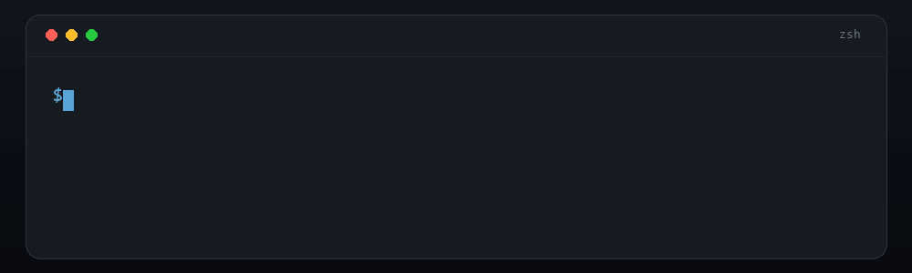

# 👋 Henry Qiao

**AI-powered HR Practitioner：用 AI 重构 HR 工作方式**

🎓 26 届｜华师汉语言文学｜AI 互联网公司 HRMT

🧭 招聘 × 培训 × 企业文化

📮 邮箱：henrybridge@qq.com

## 01 🧰 项目分享

不只研究 AI，也动手把想法变成工具。

**🛠️ 把重复活做成工具**

- [boss-zhipin-hr-greet](https://github.com/henrybridge004-hub/boss-zhipin-hr-greet) —— BOSS 直聘批量打招呼。先摸查市场、校准画像，再分批执行（每批 5 个），支持 dry-run 和操作日志。

**📐 把判断写成方法**

- [vibe-coding-playbook](https://github.com/henrybridge004-hub/vibe-coding-playbook) —— 解决“我不知道AI能做到什么”；把技术名词翻译成「什么时候用、能迁移到哪」的实践指南。[在线打开](https://henrybridge004-hub.github.io/vibe-coding-playbook/)

- [od-coach](https://github.com/henrybridge004-hub/od-coach) —— 组织诊断工具；结合十余个咨询公司常用模型与八道诊断流程，精准定位组织问题并给出解决方案。

- [performance-review-value-extraction](https://github.com/henrybridge004-hub/performance-review-value-extraction) —— 述职提炼工具。Why-How-Result-Capability，一个项目只讲一件事。

## 02 💬 一起折腾

如果你也在探索 AI 如何改变 HR 工作，欢迎来找我交流。

- 有好用的 AI 工具？一起交换工具和工作流。

- 有重复低效的 HR 工作？一起想办法把它自动化。

- 有有趣的想法还没落地？也许我们可以一起做出来。

**不论你是 HR、开发者，还是对 AI 感兴趣的管理者，都欢迎带着你的问题和作品来聊。**

最近更新：2026-11
